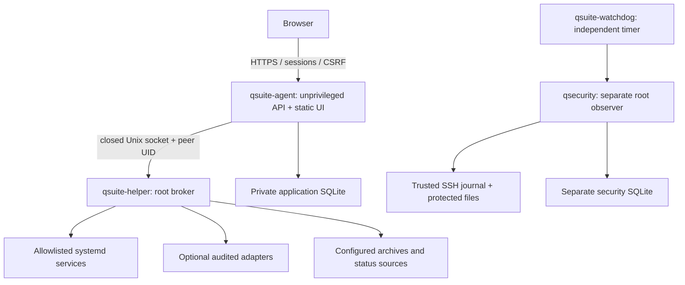

# Architecture

The browser does not receive a generic root shell execution API. Requests use
closed schemas and permission checks. The root broker accepts only the agent UID
through Linux peer credentials; it constructs fixed argument lists from root-owned
configuration. Arbitrary commands, paths and unit names are rejected. A compromised
agent could still invoke its broker allowlist; keeping that list narrow matters.

The API runs as `qsuite` without sudo. The optional PTY runs as `qsuite-terminal`,
without the helper group or supplementary groups. QSecurity and CERBERUS have
independent state and lifecycle. Managed workloads have no dependency on QSuite.

Python modules own authentication (`auth`), authorization (`permissions`), account
administration (`accounts`), API (`api`, `control_center`, `downloads`), declarative
packages (`packages`), root settings (`package_config`), notifications (`news`),
telemetry (`telemetry`), game projections (`game`) and security (`security`,
`protocols`, `watchdog`, `watchdog_news`).

The frontend is plain JavaScript/CSS in `backend/qsuite/web`; it has no Node runtime
or CDN dependency. `app.js` provides API/session helpers, `ui.js` navigation, and
`center.js` capability-driven pages. Local xterm provides terminal rendering.

Application SQLite stores accounts, hashed sessions/CSRF tokens, encrypted TOTP,
roles, jobs, news and audit. Security SQLite stores observations, risk, baselines,
scans and incidents. WAL, transactions and synchronous FULL reduce corruption
risk. Use the SQLite backup API for live snapshots. Application schema is 3;
security schema is 1. Migrations reject newer schemas and snapshot known old ones.

Jobs are capped at four queued/running and two executing. Authentication hashing,
API concurrency, broker workers, output and PTY/download lifetimes are bounded.
Interrupted jobs are marked interrupted, not automatically replayed. Audit records
operations and results, not request bodies or terminal keystrokes.

[Documentation](README.md) · [Security model](security.md)
